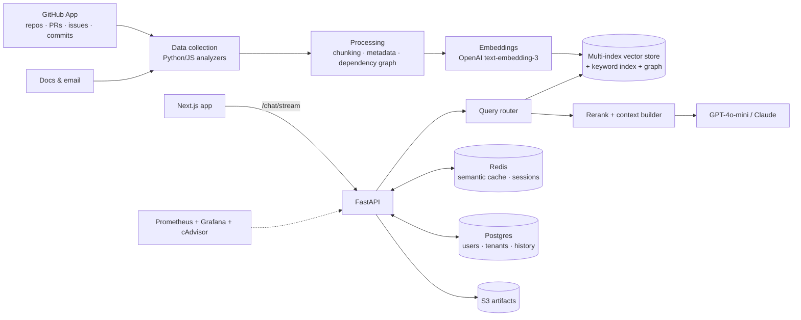

# Smarix — an AI teammate that knows your codebase

Smarix turns a company's GitHub repositories, PRs, issues, commits and docs into a
searchable knowledge base, then answers engineering questions in chat: *"who owns
the auth module?"*, *"what did PR #142 change and what could it break?"*, *"how do I
set this repo up?"*. It also powers onboarding and offboarding: knowledge capture
when an engineer leaves, and guided ramp-up when one joins.

<!-- TODO: add a screenshot or 10-second GIF of the chat + impact analyzer -->
<!--  -->

**Live demo:** _TODO_ · **Demo video:** _TODO_

## Features

- **Repository chat (RAG)**: streaming answers grounded in code, docs, PRs, issues and commits, with sources.
- **Query routing**: classifies each question and routes it to the right index (code, PR, commit, issue, docs, email, impact-analysis, traceability) or splits it into a multi-query.
- **Graph retrieval**: NetworkX dependency graphs add related files and owners to vector search results.
- **Impact analyzer & traceability**: "what breaks if I change X", and which PR / issue / commit introduced something.
- **Entity-aware semantic cache**: Redis-backed response cache that avoids false hits when PR numbers or file names differ.
- **Multi-tenant admin**: GitHub App installation, per-org data collection → processing → embedding → indexing jobs, user and role management.
- **Onboarding / offboarding** flows, plus a document analyzer and prompt builder.

## Architecture



## Tech stack

**Backend:** Python, FastAPI, NetworkX, OpenAI & Anthropic APIs, Postgres, Redis, AWS S3
**Frontend:** Next.js 15, React 19, TypeScript
**Infra:** Docker Compose, Prometheus, Grafana, cAdvisor

## My role

Co-built with Vishal Keshari as a two-person team.
<!-- TODO: confirm / edit -->
I led the chatbot and retrieval layer: GraphRAG retrieval, query routing,
token-based index logic, chatbot multi-tenancy and performance work, the storage
migration to S3, user↔repo mapping, cutting data-collection time, and the
onboarding / request-demo UI.

## Engineering highlights

<!-- TODO: replace with real numbers -->
- Cut data-collection time for large repos by _X%_ with parallel repository processing and rate-limit-aware GitHub clients.
- Semantic cache hit rate of _X%_, with entity-aware matching to prevent wrong answers about different PRs or files.
- Routing questions to specialised indices instead of one flat index improved answer relevance on PR and commit questions.

## Run locally

```bash
cp backend/.env.example backend/.env   # add OpenAI key, GitHub token, DB/Redis/AWS settings
docker compose up --build -d    # postgres, redis, backend, frontend, prometheus, grafana
```

Indexing pipeline (from `backend/`, inside a virtualenv):

```bash
python main.py                          # collect repository data
python process_data.py --batch          # chunk + enrich + build graph
python generate_embedding.py --batch    # embed
python build_indices.py                 # build vector / keyword indices
```

Stop everything with `docker compose down`.

## License

Proprietary. See [LICENSE](LICENSE).
